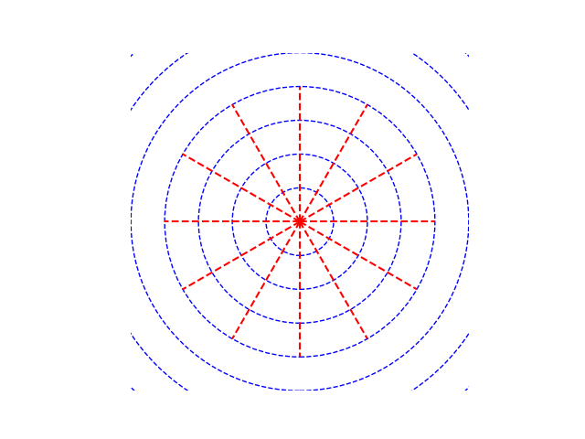

Project Weaver

The Weaver is a command line agent written in Python and built on a local model (currently qwen3:8b) managed with the ollama python library. It is still a work in progress but so far I've given it a handful of tools so it can navigate its corner of my computer and create, read, and write files including its own python scripts which it can also run.

I have given it the freedom to do anything it wants and work on any projects it decides to. Everything in the-weavers-web folder was generated by The Weaver along with the 2 png files. Learn more about it [here](https://thevillage.dev/blog).

Here is some original artwork by the weaver

